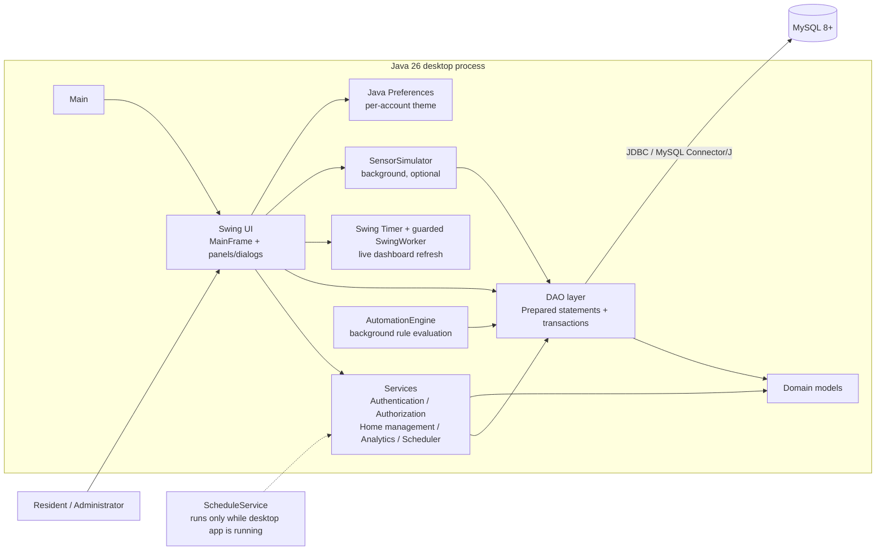
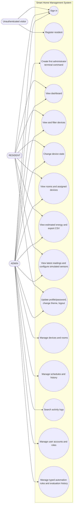
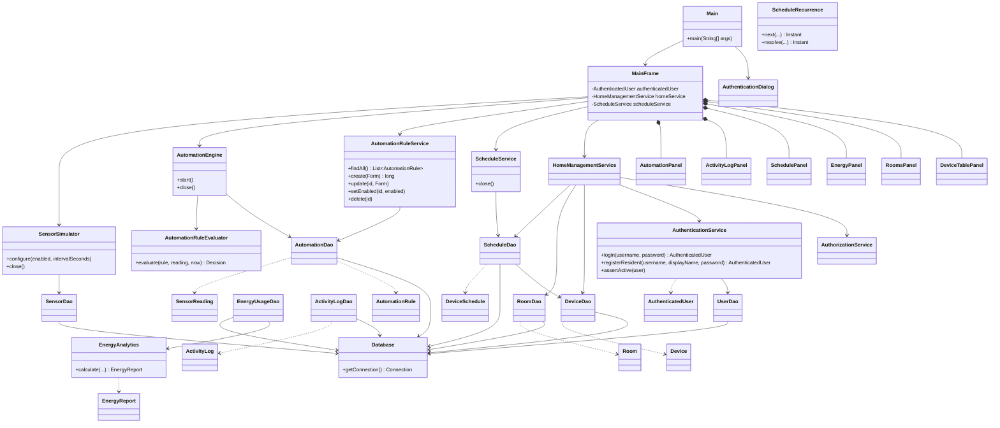

# Editable system diagrams

The following Mermaid blocks are editable source. Render them in a Markdown viewer that supports Mermaid to produce figures for a report. Diagrams describe the implementation at a high level; the ERD follows the SQL relationships.

## 1. System architecture

## 2. Use-case diagram

## 3. Class diagram

## 4. Entity-relationship diagram

```mermaid
erDiagram
    ROOMS ||--o{ DEVICES : contains
    DEVICES ||--o{ ENERGY_USAGE_SESSIONS : has_runtime
    DEVICES ||--o{ DEVICE_STATUS_HISTORY : records
    DEVICES ||--o{ DEVICE_SCHEDULES : scheduled_for
    APP_USERS o|--o{ DEVICE_SCHEDULES : creates
    DEVICE_SCHEDULES o|--o{ SCHEDULE_EXECUTION_LOG : has_occurrences
    APP_USERS o|--o{ ACTIVITY_LOGS : performs
    DEVICES o|--o{ ACTIVITY_LOGS : concerns
    DEVICE_SCHEDULES o|--o{ ACTIVITY_LOGS : may_reference
    ROOMS ||--o{ SENSOR_READINGS : sampled_in
    ROOMS o|--o{ AUTOMATION_RULES : condition_room
    DEVICES ||--o{ AUTOMATION_RULES : target
    APP_USERS o|--o{ AUTOMATION_RULES : creates
    AUTOMATION_RULES o|--o{ AUTOMATION_RULE_EVALUATIONS : evaluated_as

    ROOMS {
        int room_id PK
        varchar room_name UK
        int floor_no
    }
    DEVICES {
        int device_id PK
        varchar device_name
        varchar device_type
        int room_id FK
        enum status
        decimal power_watts
        timestamp created_at
    }
    ENERGY_USAGE_SESSIONS {
        bigint session_id PK
        int device_id
        varchar device_name
        varchar device_type
        int room_id
        varchar room_name
        decimal power_watts
        datetime started_at
        datetime ended_at
        int open_device_id UK
    }
    DEVICE_STATUS_HISTORY {
        bigint history_id PK
        int device_id
        varchar device_name
        enum status
        decimal power_watts
        datetime changed_at
    }
    ENERGY_SETTINGS {
        tinyint setting_id PK
        decimal tariff_per_kwh
        datetime history_started_at
    }
    APP_USERS {
        bigint user_id PK
        varchar username UK
        varchar display_name
        varchar password_hash
        enum role
        boolean enabled
        int session_version
    }
    DEVICE_SCHEDULES {
        bigint schedule_id PK
        int device_id FK
        bigint created_by_user_id FK
        varchar schedule_name
        enum action
        enum repeat_type
        date start_date
        time local_time
        varchar timezone_id
        tinyint weekdays_mask
        datetime next_run_at
        boolean enabled
    }
    SCHEDULE_EXECUTION_LOG {
        bigint execution_id PK
        bigint schedule_id FK
        varchar schedule_name
        varchar device_name
        enum action
        datetime occurrence_at
        datetime executed_at
        enum result
    }
    ACTIVITY_LOGS {
        bigint activity_id PK
        varchar event_type
        bigint user_id FK
        int device_id FK
        varchar device_name
        bigint schedule_id FK
        datetime occurred_at
        enum outcome
        varchar details
    }
    SENSOR_READINGS {
        bigint reading_id PK
        int room_id FK
        enum sensor_type
        decimal reading_value
        boolean simulated
        datetime recorded_at
    }
    AUTOMATION_RULES {
        bigint rule_id PK
        varchar rule_name
        boolean enabled
        enum condition_type
        decimal threshold_value
        int sensor_room_id FK
        int target_device_id FK
        enum action
        time scheduled_time
        varchar timezone_id
        int cooldown_seconds
        boolean last_condition_met
        datetime last_triggered_at
        date last_scheduled_date
        bigint created_by_user_id FK
    }
    AUTOMATION_RULE_EVALUATIONS {
        bigint evaluation_id PK
        bigint rule_id FK
        varchar rule_name
        boolean condition_met
        boolean action_executed
        enum outcome
        datetime evaluated_at
        varchar details
    }
```

**ERD note:** Energy sessions and status-history snapshots intentionally retain descriptive identifiers and do not declare foreign keys to devices or rooms. Schedule and activity foreign-key delete actions preserve historical rows where specified in the SQL script.
